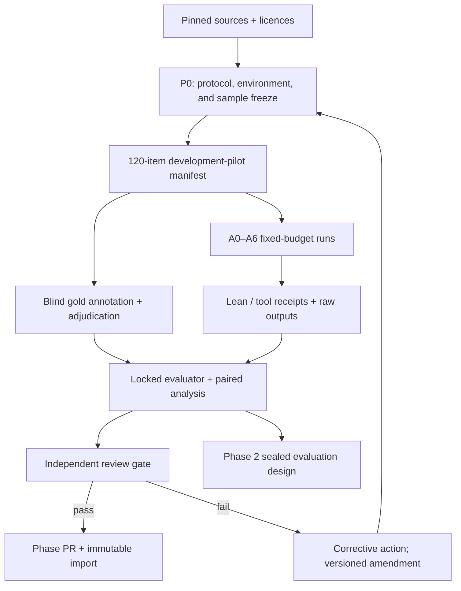
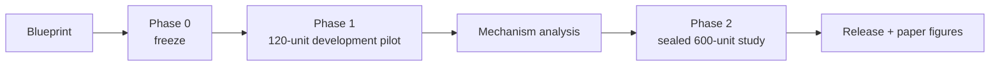

# ARC-LeanBench: scientific-claim audit blueprint (v1)

**Status:** protocol blueprint; it contains no Phase 1 outcome.  
**Owner:** ARC-Lean research program.  
**Version date:** 2026-10-29 (America/Los_Angeles).

## Executive thesis

> Formal verification is valuable at the boundary between a scientific claim
> and its explicit assumptions.  It does not, by itself, establish that the
> assumptions are faithful, identifiable, or empirically supported.

ARC-LeanBench tests that statement rather than treating a Lean compile pass as
scientific truth.  Its target unit is an **audit unit**: a source problem or
claim, a candidate analysis, an error/clean-control label, and enough
provenance to judge the candidate's logical, semantic, and empirical status.

The first 120-unit study is a **development pilot**, not a sealed benchmark and
not a claim of generalisation.  Its purpose is to validate compatibility,
label quality, measurement, and the causal contrast needed for the later
sealed study.

## Research questions and falsifiable hypotheses

| ID | Question / prediction | Primary evidence |
| --- | --- | --- |
| RQ1 / H1 | Does Lean add balanced audit accuracy on formally expressible logical errors, conditional on the rest of ARC? | Paired A6 minus A5, by formalizability |
| RQ2 / H2 | Is Lean's increment smaller on evidence insufficiency, causal overclaim, and model–world mismatch? | Exploratory Phase 1 error-family interaction; confirmatory Phase 2 interaction |
| RQ3 / H3 | Does a semantic-alignment audit reduce false confidence from a formally valid but unfaithful target? | Semantic-alignment and false-confidence rates |
| RQ4 / H4 | Does utility depend jointly on formalizability and assumption completeness? | Exploratory Phase 1 stratification; quota-powered Phase 2 test |

## What is being compared

All arms see the same frozen audit unit, source evidence allowed by the
protocol, output schema, base model snapshot, seed schedule, token cap, and
wall-clock cap.  They may never see gold labels, held-out solutions, or
post-hoc hand repair.

| Arm | Name | Deliberate additional capability |
| --- | --- | --- |
| A0 | Direct LLM | None beyond the fixed prompt |
| A1 | Structured audit | Claim / assumption / evidence decomposition |
| A2 | LLM + Python | Sandboxed numerical or symbolic checks |
| A3 | LLM + Lean | Lean target/proof generation and kernel checking |
| A4 | LLM + countermodel | Counterexample / alternate-mechanism search |
| A5 | ARC-CM, no Lean | Structured evidence, domain, numerical and countermodel audit |
| A6 | ARC-CM + Lean | A5 plus the A3 Lean endpoint and semantic boundary record |

The estimands are `A6 - A5` (Lean conditional on ARC) and `A3 - A0` (Lean
conditional on a direct LLM).  A2 and A4 prevent us from attributing every
tool-assisted improvement to formal verification.

## Error model

| Layer | Families | What a Lean success can establish |
| --- | --- | --- |
| General/formal | invalid inference, quantifier/boundary omission, algebra or specification error | A submitted proposition follows from submitted assumptions |
| Scientific formal | dimensional/physical-law error, formal derivation error, non-identifiability in an explicit model | A mathematical witness or non-uniqueness statement in the model |
| Semantic | abstraction elevation, notational collapse, observable-to-target mismatch | Nothing unless semantic fidelity is separately reviewed |
| Empirical/discovery | insufficient evidence, causal overclaim, model–world mismatch, non-discriminating experiment | Nothing by itself; evidence and experimental design are required |

Every Lean result therefore has two fields: `lean_status` and
`semantic_alignment`.  They must never be collapsed into a single validity
field.

## Dataset ladder and Phase 1 allocation

| Stratum | Pilot source and purpose | n | Status / key limitation |
| --- | --- | ---: | --- |
| General logic | miniF2F Lean 4 development pool | 30 | Positive control; public benchmark contamination remains possible |
| Scientific formalisation | FormalPhysics v2 in FormalScience | 30 | Requires explicit license/permission and a reproducible Lean environment |
| Quantitative science | SciBench: 10 each Atkins, Halliday/Fundamentals, thermodynamics | 30 | Public textbook items; not a sealed science-discovery test |
| ARC claims | Frozen ARC controlled claim/countermodel pool | 30 | Controlled / synthetic claim failures, not natural-world prevalence |
| **Total** | Four strata, 15 error + 15 clean control target per stratum | **120** | Development pilot only |

The public LeanPhysBench data are *not* a drop-in replacement for the
FormalPhysics stratum.  Its licence must be checked against the proposed model
and organisational use.  PhysLib itself is a separate formal-library
dependency and can be used only through the source-specific pinned environment.

## End-to-end architecture

## Roadmap

### Phase 0 — protocol and source freeze

Deliverables: versioned protocol, source/licence lock, per-source Lean
environment lock, resource capture transcript, frozen 120-item manifest,
prompt/arm contract, leakage policy, gold rubric, evaluator tests, and review
gate.  The manifest and all prompt/config hashes are frozen *before* any pilot
run.

### Phase 1 — 120-item development pilot

Run all 120 units through A0–A6 with three scheduled replicates.  Preserve
every output, tool transcript, budget field, failure, and abstention.  Score
with blind gold labels; produce a multi-arm/taxonomy figure, paired-effect plus
coverage/cost figure, item-level failure map, and three adjudicated case
studies.  This phase is publishable as a pilot only if the independent gate
passes; it is not called sealed.

### Phase 2 — sealed main evaluation

After—and not during—Phase 1 analysis, use a separate source-level/cluster
holdout selected and encrypted by an evaluator role.  It targets 600 audit
units over the five-level ladder (mathematics, formal science, quantitative
science, claim auditing, and discovery workflows).  No prompt, rubric, or
tooling edit can be selected using its outcomes.

## Non-negotiable interpretation rules

1. A successful Lean compile means only that the submitted term checks under
   its submitted environment and assumptions.
2. `semantic_unverified`, `tool_error`, `formal_failure`, and `verified` are
   distinct Lean statuses.
3. A clean control is required in every stratum; high error recall without
   specificity is not a useful scientific auditor.
4. Injected variants that share a source problem are clustered observations,
   not independent samples.
5. No “sealed” claim is permitted when authors can inspect or tune against the
   held-out list.  Phase 1 is explicitly a development pilot.
6. Every paper number must regenerate from raw, hash-recorded artifacts.

## Publication boundary

The intended contribution is a controlled answer to *when* formal verification
helps audit scientific reasoning, not a claim that Lean discovers empirical
truth.  The study distinguishes formal validity, semantic fidelity,
identifiability, and evidential adequacy, and reports the conditions in which
each layer fails.
